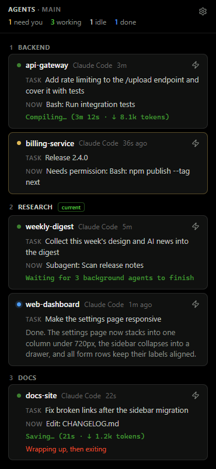

# wave-agent-board

A [Wave Terminal](https://www.waveterm.dev/) widget that shows every Claude Code session in your workspace:
what each one is doing, which ones need you, which ones just finished. Jump to any session or message it
without leaving the board.



## Features

- **Live status per session.** A dot shows the state: green while working, amber when the agent needs you,
  blue when it finished and you haven't looked yet, grey when idle.
- **What it's doing.** The task you gave it, the tool it's running right now ("Bash: Run integration tests",
  "Edit: colors.dark.json"), the live spinner line, and the last reply once it's done.
- **Go to terminal.** Switches to the right tab and focuses the terminal.
- **Message.** Type into a session from the board. The text goes straight into the terminal, with no tab switching.
  Shift+Enter starts a new line. Paste, drop or attach images: they arrive as `[Image #N]`, just like pasting
  into Claude Code itself.
- **Copy session ID.** Copies a short reference: the session ID, its transcript path and the command to message it.
  Paste it into another Claude session and that one can read the first session's full context or talk to it.
- **End session.** Exits Claude Code in that terminal (click twice to confirm). A running turn is interrupted
  first and anything typed in the prompt is cleared; then `/exit` goes in. The terminal itself stays open.
- **Sound when done.** A soft chime when an agent finishes, with adjustable volume. Handy if you run agents in
  bypass mode and rarely get permission prompts. A session with background agents still running counts as
  working, so the chime waits until they're done too.
- **Grouped by tab** in your tab order, with the current tab marked.

## Requirements

- Windows (tab switching and process launching use Windows APIs)
- [Wave Terminal](https://www.waveterm.dev/) 0.14.5 or newer
- Node.js 22.13+ (uses the built-in `node:sqlite`)
- [Claude Code](https://claude.com/claude-code)

## Install

```sh
git clone https://github.com/RomanUserExpert/wave-agent-board.git
cd wave-agent-board
npm run setup
```

`setup` adds hooks to `~/.claude/settings.json` (your existing hooks stay untouched, and a backup is written first)
and an **agents** button to Wave's widget bar (`~/.config/waveterm/widgets.json`).

To send messages from the board you also need `bin/wave-input.exe`: download it from
[Releases](https://github.com/RomanUserExpert/wave-agent-board/releases) into `bin/`, or build it with Go 1.22+:

```sh
npm run build
```

Start a new Claude Code session in Wave and click **agents**. The server starts by itself on the first hook event;
to start it by hand, run `npm start` in any Wave terminal.

To remove everything: `npm run uninstall`.

## How it works

```
Claude Code hooks ──► ~/.wave-agent-board/status/<blockid>.json
                                   │
Wave DB (tabs, order) ──► server.mjs (127.0.0.1:7788) ◄── wsh termscrollback (what's on screen)
                                   │
                         index.html in a Wave web widget
```

- **`src/hook.mjs`** runs on Claude Code hook events and records the session state, keyed by Wave's
  `WAVETERM_BLOCKID`. It never prints to stdout and always exits 0, so it can't disturb Claude.
- **`src/server.mjs`** reads tabs and their order from Wave's database (read-only) and each terminal's screen via
  `wsh termscrollback`. Hooks supply the meaning (task, tool); the screen tells whether the agent is actually
  running right now, which also covers sessions started before the hooks were installed.
- **Go to terminal.** Wave 0.14.5 has no `wsh` command to switch tabs, so the server presses Wave's own tab
  shortcuts (Alt+1…8, or Alt+] / Alt+[ beyond that) with `keybd_event` from a persistent PowerShell, always
  releasing Alt afterwards, then runs `wsh focusblock`.
- **Message.** `wave-input/` is a small Go program (standard library only) that speaks Wave's RPC protocol over
  its socket, authenticates with `WAVETERM_JWT`, and calls `controllerinput`, which writes into the terminal's PTY.
  Multi-line text goes in as a bracketed paste. Images are saved to `~/.wave-agent-board/images/` (kept a week) and
  their paths are pasted in place of each `[Image #N]`; Claude Code turns a pasted image path into an attachment.
- **Background processes.** Claude Code runs hooks in a Windows job object that kills every child process when the
  hook exits, so the server and the fallback chime are launched through WMI.

## Security

The server listens on `127.0.0.1` only. Because it can type into your terminals, every API call is checked:
the `Host` and `Origin` headers must point at the board itself, and write requests must carry an
`X-Agent-Board` header, which forces a CORS preflight that the server never approves. Other web pages
can't reach it.

The hook stores Wave's environment, including `WAVETERM_JWT`, in `~/.wave-agent-board/wave-env.json` so a
server started from a hook can call `wsh`. That's the same token every Wave terminal already has in its environment.

## Files

| Path | What's there |
|---|---|
| `~/.wave-agent-board/status/` | One status file per terminal |
| `~/.wave-agent-board/config.json` | Sound on/off and volume |
| `~/.wave-agent-board/seen.json` | When you last looked at each finished session |
| `~/.wave-agent-board/images/` | Images sent from the board, deleted after a week |
| `~/.wave-agent-board/server.log` | Server log |

## License

[MIT](LICENSE)
